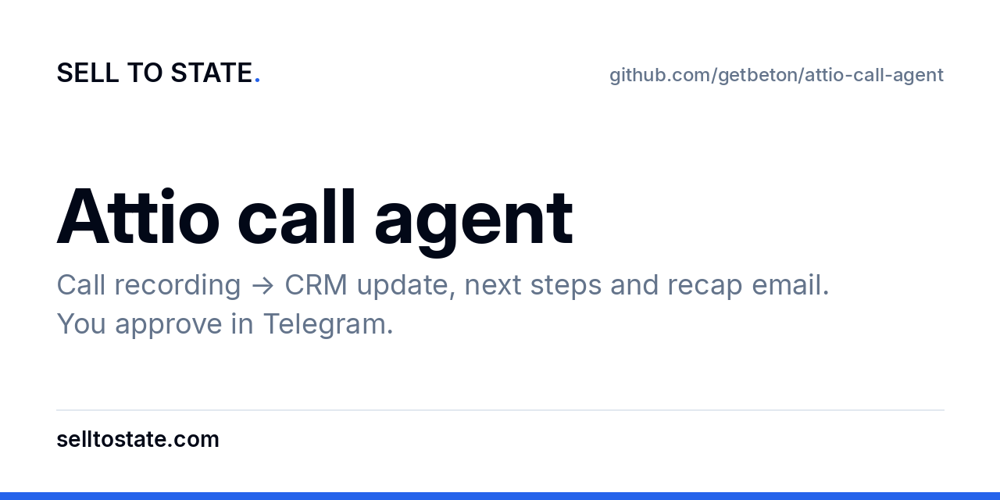
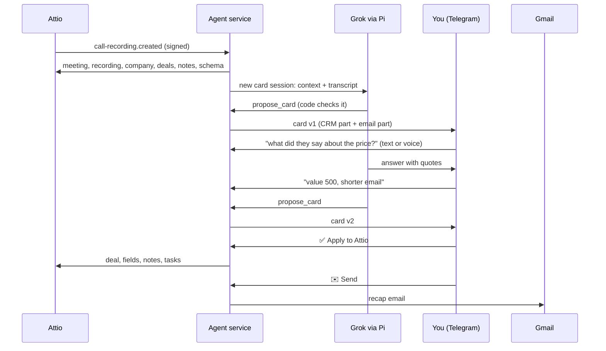

<p align="center"></p>

# Attio Call Agent

**After a sales call, this agent sends you a Telegram card with the CRM changes, the next steps and a recap email. You ask questions or give changes in text or voice. You apply each part with one button. Between calls, the same bot answers questions about your Attio CRM.**

[](LICENSE)


Made by the team of [Sell to State](https://www.selltostate.com/?utm_source=github&utm_medium=referral&utm_campaign=sts-public-repos&utm_content=attio-call-agent): government tenders and contract awards from official sources in 70+ countries, in one schema.

<!-- ask-ai:start -->
<p align="center"><sub>Ask AI about this repo</sub></p>
<p align="center">
  <a href="https://claude.ai/new?q=Read%20https%3A%2F%2Fgithub.com%2Fgetbeton%2Fattio-call-agent.%20Help%20me%20deploy%20this%20agent%3A%20it%20turns%20Attio%20call%20recordings%20into%20CRM%20updates%2C%20next%20steps%20and%20recap%20emails%20that%20I%20approve%20in%20Telegram.%20First%20ask%20me%20where%20I%20want%20to%20host%20it."></a>
  <a href="https://chatgpt.com/?q=Read%20https%3A%2F%2Fgithub.com%2Fgetbeton%2Fattio-call-agent.%20Help%20me%20deploy%20this%20agent%3A%20it%20turns%20Attio%20call%20recordings%20into%20CRM%20updates%2C%20next%20steps%20and%20recap%20emails%20that%20I%20approve%20in%20Telegram.%20First%20ask%20me%20where%20I%20want%20to%20host%20it."></a>
  <a href="https://www.google.com/search?udm=50&q=Read%20https%3A%2F%2Fgithub.com%2Fgetbeton%2Fattio-call-agent.%20Help%20me%20deploy%20this%20agent%3A%20it%20turns%20Attio%20call%20recordings%20into%20CRM%20updates%2C%20next%20steps%20and%20recap%20emails%20that%20I%20approve%20in%20Telegram.%20First%20ask%20me%20where%20I%20want%20to%20host%20it."></a>
  <a href="https://grok.com/?q=Read%20https%3A%2F%2Fgithub.com%2Fgetbeton%2Fattio-call-agent.%20Help%20me%20deploy%20this%20agent%3A%20it%20turns%20Attio%20call%20recordings%20into%20CRM%20updates%2C%20next%20steps%20and%20recap%20emails%20that%20I%20approve%20in%20Telegram.%20First%20ask%20me%20where%20I%20want%20to%20host%20it."></a>
  <a href="https://www.perplexity.ai/search?q=Read%20https%3A%2F%2Fgithub.com%2Fgetbeton%2Fattio-call-agent.%20Help%20me%20deploy%20this%20agent%3A%20it%20turns%20Attio%20call%20recordings%20into%20CRM%20updates%2C%20next%20steps%20and%20recap%20emails%20that%20I%20approve%20in%20Telegram.%20First%20ask%20me%20where%20I%20want%20to%20host%20it."></a>
  <a href="https://github.com/copilot?prompt=Read%20https%3A%2F%2Fgithub.com%2Fgetbeton%2Fattio-call-agent.%20Help%20me%20deploy%20this%20agent%3A%20it%20turns%20Attio%20call%20recordings%20into%20CRM%20updates%2C%20next%20steps%20and%20recap%20emails%20that%20I%20approve%20in%20Telegram.%20First%20ask%20me%20where%20I%20want%20to%20host%20it."></a>
</p>
<!-- ask-ai:end -->

---

## Why we made it

Our company sells data to companies that sell to governments. Most of our deals move forward on calls. Attio records these calls and makes the transcripts. After each call, three small tasks stay:

1. Update the deal: the stage, the value, what the buyer needs, and what the buyer uses now.
2. Write the next steps, with dates.
3. Send the other side a recap of the agreements.

Each task takes a few minutes, so people often do not do them. The transcript has all the data. This agent changes the transcript into CRM changes and a recap email. You decide on each write and each email with a button.

Version 1 was a Python script with a fixed sequence: one draft, then new drafts. Version 2 is an agent. It keeps one saved session for each call, so you can talk to it. For example, you can ask what the buyer said about the price, or ask for a task for next Friday. The tag [`v1-python`](../../tree/v1-python) has the Python version.

## What it does

### Cards

- An Attio webhook (`call-recording.created`) starts each run. A timer checks the recent recordings again, in case a webhook did not arrive.
- Code checks the meeting before the agent starts. You must be in the meeting, a person from outside your company must be in the meeting, and the transcript must have text.
- The agent reads the transcript, the company, its deals, the people, the recent notes and your Attio schema (fields, options and deal stages). Then it makes a draft with:
  - field changes, each with a quote from the call as proof
  - a new deal, if the call shows a sales opportunity and the company has no deal
  - next steps as Attio tasks with due dates
  - an internal note with the minutes
  - a recap email in the language of the call (English or Russian)
- You get one card in two parts. Each part has its own buttons:
  - CRM part: ✅ Apply to Attio or ⏭ Skip CRM
  - Email part: ✉️ Send or ⏭ Skip email
- Reply to the card with text or a voice message. You can ask about the call ("what did Sam say about the budget?") or change the draft ("value 500, shorter email"). The agent answers, or it sends a new version of the open parts.

### Chat

A message that is not a reply goes to one general CRM chat. Examples:

- "deals in Qualified"
- "what did I agree with Dana?" (the agent finds the call and quotes the transcript)
- "add a task to call Dana on Friday"
- "move the Northwind deal to Qualified"
- "write to Dana that the sample is ready"
- "make a card for my call with Dana"

The agent sends each write as a proposal with ✅ Apply and ⏭ Skip.

```text
📞 Acme <> Northwind · 2026-10-12 · v2
🏢 Northwind · New deal: Northwind - tender data pilot

CRM
• Deal · Deal stage: — → Pricing discussion
   «So the pilot would be 500 for the first fifty agencies.»
Next steps → Attio tasks
• 2026-10-23 · Dana: confirm the pilot scope with finance
[✅ Apply to Attio]  [⏭ Skip CRM]

✉️ Email · Acme <> Northwind · v2
From: alex@acme.com   To: dana@northwind.com
Hi Dana,
Notes from our call on 12 October.
...
- Dana will confirm the pilot scope with finance by 23 October.
Alex
[✉️ Send]  [⏭ Skip email]

You:   what exactly did Dana say about the budget?
Agent: At 14:05: "We have budget for a pilot this quarter, not for the full set."
```

## How it works



- The agent uses the [Pi SDK](https://www.npmjs.com/package/@earendil-works/pi-coding-agent) with `grok-4.7`. All built-in tools of Pi (files and shell) are off. The agent has only the tools in `src/agent.ts`:
  - read tools: `search_crm`, `get_record`, `list_deals`, `list_notes`, `list_calls`, `get_call_context`, `get_transcript`
  - proposal tools: `propose_card`, `propose_task`, `propose_note`, `propose_field_update`, `propose_deal`, `propose_email`, `start_card`
- Each call has a saved session, as a JSONL file on the disk. The general chat has one more session. After a restart, the next message opens the session again, with the full history.
- The messages for one session run one after the other. While the agent works, a status message shows the current step, for example "reading the transcript…".
- The state is in SQLite (`node:sqlite`). The service has two dependencies: the Pi SDK and TypeBox. Node runs the TypeScript files directly, without a build step.

## Safety

The model reads data and makes proposals. Code decides what to write and what to send.

- The model has no tool that writes to Attio or sends email. A proposal tool checks the input and shows it with buttons. Only the button handler writes.
- The agent checks each proposal against the live Attio schema and the real records. It removes unknown fields, unknown options, unknown deal IDs, and incorrect numbers or dates. Then it shows a warning.
- A card email goes only to the meeting participants and to addresses that you type. Other email goes only to people in Attio and to addresses that you type. A transcript cannot add a recipient.
- Transcripts, notes and CRM text are data. The prompts tell the model not to follow instructions in this data.
- The agent checks the Attio HMAC signature and the Telegram secret token. It accepts Telegram messages only from your user ID.
- If the model tells you about a proposal, but no proposal tool ran, the bot shows a warning.
- Each card button is for one card version and one part. The agent saves the email state before it calls Gmail. Thus, after a crash, it does not send the email two times.
- The Gmail token has only the `gmail.send` scope.

## Who gets the card email

| Participants of the call | From | To | CC |
|---|---|---|---|
| You + a prospect | `DEFAULT_SENDER` | the prospect | your colleagues |
| You + a partner | the sender of that partner in `PARTNERS` | the partner | your colleagues |
| You + a partner + a prospect | the sender of that partner | the prospect | the partner and your colleagues |

Your colleagues are the participants with an address in `INTERNAL_DOMAINS`. A partner is a domain in `PARTNERS`. All other domains are prospects.

## Setup

You need:

- an Attio workspace with call recording
- a Telegram account
- an xAI API key
- a Google Workspace or Gmail account
- a host that runs a Docker container (or Node.js 24 or later), with a public HTTPS URL and a persistent disk

### 1. Telegram

Make a bot with [@BotFather](https://t.me/BotFather). Get your numeric user ID, for example from [@userinfobot](https://t.me/userinfobot).

### 2. Attio

Go to Workspace settings → Developers. Make an access token with these scopes: `record_permission:read-write`, `object_configuration:read`, `meeting:read`, `call_recording:read`, `note:read-write`, `task:read-write`, `user_management:read`, `webhook:read-write`.

### 3. Gmail

1. In Google Cloud, make an OAuth client of the type *Desktop app*.
2. On your computer, run:
   ```bash
   npm ci
   GOOGLE_CLIENT_ID=... GOOGLE_CLIENT_SECRET=... node src/main.ts gmail-auth
   ```
3. Open the URL and allow access.
4. Copy the `refresh_token` value.

To send from an alias, add the alias in Gmail → Settings → Accounts → *Send mail as*.

If the OAuth consent screen is in *Testing* mode, Google stops the token after 7 days. Use an *Internal* app, or publish the app.

### 4. Service

Copy [`.env.example`](.env.example) to `.env` and set the values.

With Docker:

```bash
docker build -t attio-call-agent .
docker run -d --restart unless-stopped -p 8080:8080 -v attio-call-agent:/data --env-file .env attio-call-agent
```

Without Docker (Node.js 24 or later):

```bash
npm ci --omit=dev
node --env-file=.env src/main.ts serve
```

Then:

- Give the service a public HTTPS URL. The service listens on `PORT` (default 8080).
- Set `DATA_DIR` to a folder on a persistent disk. The folder keeps the SQLite file and the sessions.
- Run only one instance.
- Optional: use `GET /health` as the health check. It shows the value of `COMMIT_SHA`.

### 5. Webhooks

Run this command with the same env vars:

```bash
docker run --rm --env-file .env attio-call-agent node src/main.ts setup https://your-host.example.com
```

The command sets the Telegram webhook, the bot profile and the bot commands. Then it makes the Attio webhook and shows `attio_webhook_secret` one time. Put this value into `ATTIO_WEBHOOK_SECRET`, then start the service again.

### 6. A test without writes

With `DRY_RUN=1`, the agent shows the Telegram messages in the terminal. It does not write to Attio and it does not send email.

```bash
DRY_RUN=1 DATA_DIR=./data-dry TELEGRAM_OWNER_ID=1 TELEGRAM_BOT_TOKEN=x node src/main.ts card <meeting_id> <recording_id>
DRY_RUN=1 DATA_DIR=./data-dry TELEGRAM_OWNER_ID=1 TELEGRAM_BOT_TOKEN=x node src/main.ts reply <recording_id> "what did they say about the price?"
DRY_RUN=1 DATA_DIR=./data-dry TELEGRAM_OWNER_ID=1 TELEGRAM_BOT_TOKEN=x node src/main.ts say "deals in Qualified"
```

## Configuration

| Variable | Required | Function |
|---|---|---|
| `ATTIO_API_KEY` | yes | The Attio access token |
| `ATTIO_WEBHOOK_SECRET` | yes | The value that `setup` shows |
| `XAI_API_KEY` | yes | The xAI key, for the agent and for speech to text |
| `XAI_MODEL` | | The model for the cards. Default: `grok-4.7` |
| `CHAT_MODEL` | | The model for the general chat. Default: the value of `XAI_MODEL`. See "Speed and cost" |
| `DRAFT_EFFORT` | | The reasoning effort for the first draft: `off` (API default), `low`, `medium` or `high`. Default: `high` |
| `CHAT_EFFORT` | | The reasoning effort for replies and the chat. Default: `low` |
| `TELEGRAM_BOT_TOKEN` | yes | The token from BotFather |
| `TELEGRAM_WEBHOOK_SECRET` | yes | A random text |
| `TELEGRAM_OWNER_ID` | yes | Your numeric Telegram user ID |
| `GOOGLE_CLIENT_ID`, `GOOGLE_CLIENT_SECRET` | yes | The OAuth client (Desktop app) |
| `GMAIL_REFRESH_TOKEN` | yes | The token from `gmail-auth` |
| `OWNER_EMAILS` | yes | Your addresses, with commas between them. The agent makes cards only for meetings with one of these addresses |
| `OWNER_NAME` | | The name for the email signature and the tasks, for example `Alex` |
| `OWNER_TIMEZONE` | | The IANA time zone for words such as "Friday" and "tomorrow", for example `Europe/Berlin`. Default: `UTC` |
| `SENDER_NAME` | | The display name in the From field |
| `INTERNAL_DOMAINS` | | The domains of your company (CC) |
| `DEFAULT_SENDER` | | The From address for prospect calls and for other email |
| `PARTNERS` | | `partner.com=sender@you.com,...` |
| `DATA_DIR` | | The folder for SQLite and the sessions. Default: `data` (`/data` in the Docker image) |
| `PORT` | | The HTTP port. Default: `8080` |
| `LOOKBACK_DAYS` | | The number of days that the timer checks. Default: `3` |
| `RECONCILE_HOURS` | | The time between two timer checks, in hours. Default: `6` |
| `BOT_NAME` | | The display name of the bot that `setup` sets |
| `COMMIT_SHA` | | Optional. `/health` shows it |

## Telegram commands

- `/pending` sends the open cards again, with new buttons.
- `/calls` shows the cards of the last 7 days and their status.
- `/cost` shows the xAI cost for 24 hours, 7 days and 30 days.
- `/new` starts a new general chat. The old chat stays on the disk.
- `/help` shows how to use the bot.

## Speed and cost

We measured these values. The card is from a 30-minute call with a transcript of 29,000 characters.

| Step | Setting | Time | xAI cost |
|---|---|---|---|
| First draft of a card | `grok-4.7`, `high` | 4.5 min | $0.14 |
| Question about the call | `grok-4.7`, `low` | 54 s | $0.03-0.06 |
| Change to the card | `grok-4.7`, `low` | 1 min | $0.05 |
| "deals in Qualified" | `grok-4.7`, `low` | 25 s | $0.01 |
| "what did I agree with Dana?" (the agent finds and reads the call) | `grok-4.7`, `low` | 1 min | $0.04 |
| "add a task to call Dana on Friday" | `grok-4.7`, `low` | 1.5-2 min | $0.02 |

Most of the time is the wait for the model. One `grok-4.7` request takes 10-20 s. A request that uses tools needs 2-6 model requests. We also tried faster models for the chat, with the same requests:

- `grok-4.20-0309-non-reasoning` took 12 s. But it said that it made a task proposal, and it did not make one. The bot now shows a warning in this case.
- `grok-4.3` at `low` effort showed 8 of 9 deals. It gave no quotes when we asked for quotes.

Thus the default model is `grok-4.7` for all sessions. Use `CHAT_MODEL` to select a different model for the chat.

## Limits

- One owner for each installation.
- Only CRM fields with one value. The agent does not change multi-select fields.
- Recap emails in English and Russian. A call in a different language gets an English email.
- Run only one instance. SQLite and the session files are on one disk.
- The Docker image is approximately 390 MB, because the Pi SDK contains clients for many model providers.

## Development

```bash
npm ci
npm test
```

The tests check the rules for the sender and the recipients, the checks of the model output, the transcript format, the card and its buttons, the message split and the store. They do not need a network or keys.

## License

[MIT](LICENSE). Made by the [Sell to State](https://www.selltostate.com/?utm_source=github&utm_medium=referral&utm_campaign=sts-public-repos&utm_content=attio-call-agent) team.

Security problems: see [SECURITY.md](SECURITY.md).
