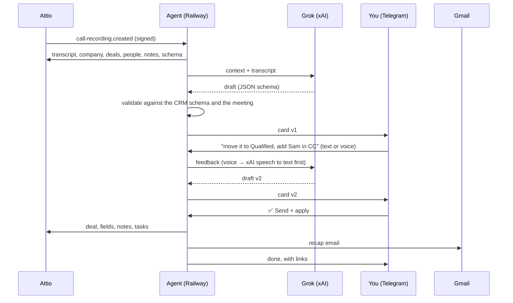

# Attio Call Agent

**Your sales call ends. A few minutes later, Telegram shows the CRM update, the next steps and the recap email. You correct the draft by text or voice. One tap writes Attio and sends the email.**

[](LICENSE)


Built by the team behind **[Sell to State](https://selltostate.com)**: structured government procurement data across 194 countries, with tenders, suppliers and agencies in one entity graph.

---

## Why we built it

We sell data to companies that sell to governments, so most of our pipeline moves on calls. Attio records those calls and makes the transcripts. After each call, three small jobs remain:

1. Update the deal: stage, value, what the buyer needs, what they use now.
2. Write down the next steps, with dates.
3. Send the other side a recap of what we agreed.

Each job takes a few minutes, so the jobs slip. Then the deal shows a stale stage, nobody owns the next step, and the buyer gets no written record. The transcript has all the data. This agent turns the transcript into structured changes and a recap email, and **a person approves each write and each send**.

## What it does

- **Starts by itself.** An Attio `call-recording.created` webhook starts each run. A timer re-checks recent recordings in case a webhook was lost.
- **Reads the full context.** It reads the transcript, the company, its deals, the people, the last notes, and your Attio schema: fields, select options and deal stages.
- **Makes a draft with Grok:**
  - field changes, each with a quote from the call as evidence
  - a new deal when the call shows an opportunity and the company has no deal
  - next steps as Attio tasks with due dates
  - an internal minutes note
  - a recap email in the language of the call (English or Russian)
- **Sends you one Telegram card.** Reply with text or a **voice note** to change the draft. The agent makes a new version.
- **Applies on your tap.** ✅ **Send + apply** updates Attio, writes the note and tasks, and sends the email from Gmail. 🗂 **CRM only** skips the email. ⏭ **Skip** closes the card.

```text
📞 Acme <> Northwind · 2026-10-12 · v2
🏢 Northwind · New deal: Northwind - tender data pilot

Pricing call. Northwind will decide on a 50-agency pilot next week.

CRM
• Deal · Deal stage: — → Pricing discussion
   «So the pilot would be 500 for the first fifty agencies.»
• Company · CRM: — → HubSpot
   «Everything lives in HubSpot today.»

Next steps → Attio tasks
• 2026-10-20 · Alex: send the sample for three agencies
• 2026-10-23 · Dana: confirm the pilot scope with finance

✉️ Email from alex@acme.com
To: dana@northwind.com
Subject: Notes from our call

Hi Dana,

Notes from our call today.
...

[✅ Send + apply]  [🗂 CRM only]  [⏭ Skip]
```

## How it works



The agent is a single Python file that uses only the standard library. It runs as one process with three parts:

| Part | Job |
|---|---|
| HTTP server | `/attio` and `/telegram` webhooks, `/health` |
| Worker thread | Runs every job in order: new recording, Telegram reply, button tap |
| Timer | Every `RECONCILE_HOURS`, lists the recordings of the last `LOOKBACK_DAYS` and runs the ones it has not seen |

State is one SQLite file on a volume.

## Safety

The model writes drafts. Code decides what is written and sent.

- **No write and no send without your tap.** The model cannot call Attio or Gmail.
- **Model output is validated** against your live Attio schema. The agent drops unknown fields, unknown select options, unknown deal IDs and bad numbers or dates, and shows a warning on the card.
- **Recipients are limited** to the meeting participants and the addresses that you type in feedback. The transcript cannot add a recipient.
- **The transcript is data.** The prompt tells the model to ignore instructions inside it.
- **Signed webhooks.** The agent checks the Attio HMAC signature and the Telegram secret token. It accepts Telegram messages from your user ID only.
- **No double sends.** Each button is tied to one card version. The agent saves the email state before it calls Gmail. After a crash, it does not send again. It tells you to check the Sent folder.
- **Safe retries.** The agent saves each finished step. A second tap does only the steps that remain.
- **Small Gmail scope.** The token has `gmail.send` only. It cannot read your mailbox.

## Who gets the email

| On the call | From | To | CC |
|---|---|---|---|
| You + a prospect | `DEFAULT_SENDER` | the prospect | your colleagues |
| You + a partner | the partner's sender from `PARTNERS` | the partner | your colleagues |
| You + a partner + a prospect | the partner's sender | the prospect | the partner and your colleagues |

"Colleagues" are participants at `INTERNAL_DOMAINS`. A partner is a domain in `PARTNERS`. All other domains are prospects. The agent skips meetings that have no outside participant, and meetings that you did not attend.

## Setup

You need an Attio workspace with call recording, a Telegram account, an xAI API key and a Google Workspace or Gmail account.

1. **Telegram.** Create a bot with [@BotFather](https://t.me/BotFather). Get your numeric user ID, for example from [@userinfobot](https://t.me/userinfobot).
2. **Attio.** Go to Workspace settings → Developers and create an access token with these scopes: `record_permission:read-write`, `object_configuration:read`, `meeting:read`, `call_recording:read`, `note:read-write`, `task:read-write`, `user_management:read`, `webhook:read-write`.
3. **Gmail.** In Google Cloud, create an OAuth client of type *Desktop app*. Then, on your laptop, run:
   ```bash
   GOOGLE_CLIENT_ID=... GOOGLE_CLIENT_SECRET=... python agent.py gmail-auth
   ```
   Open the URL, allow access, and copy `refresh_token`. To send from an alias, add it in Gmail → Settings → Accounts → *Send mail as*.
   If the OAuth consent screen is in *Testing* mode, Google expires the token after 7 days. Use an *Internal* app or publish the app.
4. **Deploy on Railway.**
   1. Fork this repo.
   2. Create a Railway project from the fork. Railway finds the `Dockerfile`.
   3. Add a volume at `/data`.
   4. Set the env vars from [`.env.example`](.env.example).
   5. Generate a public domain.
   6. Optional: in the service settings, set the healthcheck path to `/health`. Keep one replica.
5. **Connect the webhooks.** Run this with the same env vars:
   ```bash
   python agent.py setup https://your-service.up.railway.app
   ```
   This command sets the Telegram webhook and the bot profile, then creates the Attio webhook. It prints `attio_webhook_secret` one time. Put the secret into `ATTIO_WEBHOOK_SECRET` on Railway.
6. **Test without writes.** Choose a recorded meeting and run:
   ```bash
   python agent.py preview <meeting_id> <recording_id>
   ```
   The command prints the card and the validated plan. It does not write to Attio and does not send anything.

## Configuration

| Variable | Required | Meaning |
|---|---|---|
| `ATTIO_API_KEY` | yes | Attio access token |
| `ATTIO_WEBHOOK_SECRET` | yes | Printed by `setup` |
| `XAI_API_KEY` | yes | xAI key, for the drafts and for speech to text |
| `XAI_MODEL` | | Default `grok-4.7` |
| `XAI_REDRAFT_EFFORT` | | Reasoning effort for redrafts. Default `low` |
| `XAI_STT_MODEL` | | Default `grok-voice-transcribe-2.0` |
| `TELEGRAM_BOT_TOKEN` | yes | From BotFather |
| `TELEGRAM_WEBHOOK_SECRET` | yes | Any random string |
| `TELEGRAM_OWNER_ID` | yes | Your numeric Telegram user ID |
| `GOOGLE_CLIENT_ID`, `GOOGLE_CLIENT_SECRET` | yes | OAuth client (Desktop app) |
| `GMAIL_REFRESH_TOKEN` | yes | From `gmail-auth` |
| `OWNER_EMAILS` | yes | Your addresses, comma-separated. The agent runs only on meetings with one of them |
| `OWNER_NAME` | | Sign-off name and task prefix, for example `Alex` |
| `SENDER_NAME` | | Display name in the From header |
| `INTERNAL_DOMAINS` | | Your company domains (CC) |
| `DEFAULT_SENDER` | | The From address for prospect calls |
| `PARTNERS` | | `partner.com=sender@you.com,...` |
| `DATA_DIR` | | SQLite folder. Default `data` (`/data` in Docker) |
| `LOOKBACK_DAYS` | | How far back the timer looks. Default `3` |
| `RECONCILE_HOURS` | | Timer interval. Default `6` |
| `BOT_NAME` | | Bot display name that `setup` sets |

## Speed and cost

These numbers come from a 30-minute call: a 29k-character transcript and a 12k-token prompt.

| Step | Model setting | Time | Tokens |
|---|---|---|---|
| First draft | `grok-4.7`, default reasoning | ~4.5 min | 12k in, ~25k reasoning, ~1.6k out |
| Redraft | `grok-4.7`, `reasoning_effort=low` | ~70 s | 12k in, ~4k reasoning, ~1.7k out |

The first draft runs in the background after Attio finishes the transcript. You wait only for redrafts.

## Telegram commands

- Reply to a card with text or voice to change that card. A message that is not a reply goes to the newest open card.
- `/pending` lists the open cards.
- `/help` shows the usage.

## Limits

- One owner for each deployment.
- Single-value fields only. The agent skips multi-select fields.
- Recap emails in English and Russian. A call in another language gets an English email.
- SQLite on a volume: run one replica only.

## Development

```bash
python -m unittest discover -s tests -v
```

The tests cover routing, the validation of model output, the transcript format, the card split, signatures and the store. They need no network and no keys.

## License

[MIT](LICENSE). Made by [Beton](https://github.com/getbeton) for [Sell to State](https://selltostate.com).
