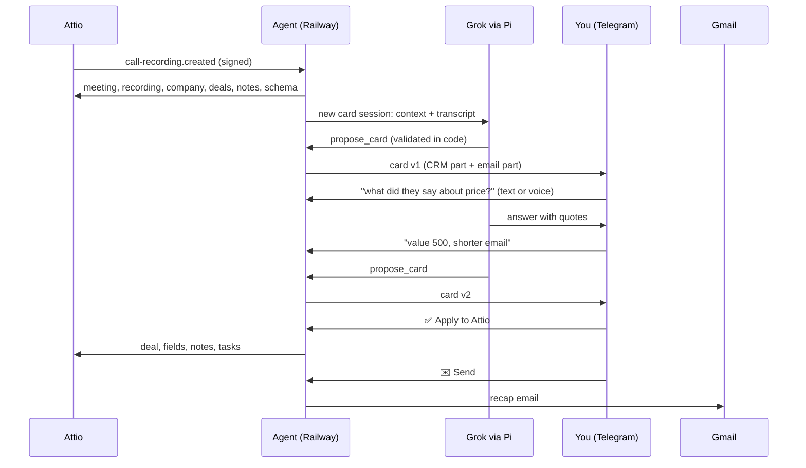

# Attio Call Agent

**Your sales call ends. A few minutes later, Telegram shows the CRM update, the next steps and the recap email. Ask the agent about the call, correct it by text or voice, and approve each part with one tap. Between calls, the same bot answers questions about your CRM.**

[](LICENSE)


Built by the team behind **[Sell to State](https://selltostate.com)**: structured government procurement data across 194 countries, with tenders, suppliers and agencies in one entity graph.

---

## Why we built it

We sell data to companies that sell to governments, so most of our pipeline moves on calls. Attio records those calls and makes the transcripts. After each call, three small jobs remain:

1. Update the deal: stage, value, what the buyer needs, what they use now.
2. Write down the next steps, with dates.
3. Send the other side a recap of what we agreed.

Each job takes a few minutes, so the jobs slip. The transcript has all the data. This agent turns the transcript into structured changes and a recap email, and **a person approves each write and each send**.

Version 1 was a fixed Python pipeline: one draft, then redrafts. Version 2 is an agent with a saved session for each call, so you can also *talk* to it: ask what the buyer said about price, ask for a task next Friday, or ask which deals are stuck. The Python version is in the tag [`v1-python`](../../tree/v1-python).

## What it does

### Cards
- An Attio `call-recording.created` webhook starts each run. A timer re-checks recent recordings in case a webhook was lost.
- Code checks the meeting first: you attended, someone from outside your company attended, and the transcript is not empty.
- The agent reads the transcript, the company, its deals, people, recent notes and your Attio schema (fields, options, deal stages). It drafts:
  - field changes, each with a quote from the call as evidence
  - a new deal when the call shows an opportunity and the company has no deal
  - next steps as Attio tasks with due dates
  - an internal minutes note
  - a recap email in the language of the call (English or Russian)
- You get one card in two parts, and each part has its own buttons:
  - CRM part: ✅ Apply to Attio or ⏭ Skip CRM
  - Email part: ✉️ Send or ⏭ Skip email
- Reply to the card with text or a voice note. Ask about the call ("what did Sam say about the budget?") or change the draft ("value 500, shorter email"). The agent answers or posts a new version of the open parts.

### Chat
A message that is not a reply goes to one general CRM chat:

- "deals in Qualified"
- "what did I agree with Dana?" (the agent finds the call and quotes the transcript)
- "add a task to call Dana on Friday"
- "move the Northwind deal to Qualified"
- "write to Dana that the sample is ready"
- "make a card for my call with Dana"

Every write comes as a proposal with ✅ Apply / ⏭ Skip.

```text
📞 Acme <> Northwind · 2026-10-12 · v2
🏢 Northwind · New deal: Northwind - tender data pilot

CRM
• Deal · Deal stage: — → Pricing discussion
   «So the pilot would be 500 for the first fifty agencies.»
Next steps → Attio tasks
• 2026-10-23 · Dana: confirm the pilot scope with finance
[✅ Apply to Attio]  [⏭ Skip CRM]

✉️ Email · Acme <> Northwind · v2
From: alex@acme.com   To: dana@northwind.com
Hi Dana,
Notes from our call on 12 October.
...
- Dana will confirm the pilot scope with finance by 23 October.
Alex
[✉️ Send]  [⏭ Skip email]

You:   what exactly did Dana say about the budget?
Agent: At 14:05: "We have budget for a pilot this quarter, not for the full set."
```

## How it works



- The agent runs on the [Pi SDK](https://www.npmjs.com/package/@earendil-works/pi-coding-agent) with `grok-4.7`. All built-in coding tools are off. The agent has only the tools in `src/agent.ts`:
  - read tools: `search_crm`, `get_record`, `list_deals`, `list_notes`, `list_calls`, `get_call_context`, `get_transcript`
  - proposal tools: `propose_card`, `propose_task`, `propose_note`, `propose_field_update`, `propose_deal`, `propose_email`, `start_card`
- Each call has a saved session (JSONL on the volume). The general chat has one more. A restart loses nothing: the next message reopens the session.
- Messages for one session run in order. While the agent works, a status message shows the current step, for example "reading the transcript…".
- State is in SQLite (`node:sqlite`). The only dependencies are the Pi SDK and TypeBox. Node runs the TypeScript directly; there is no build step.

## Safety

The model reads and proposes. Code decides what is written and sent.

- The model has no tool that writes to Attio or sends email. Proposal tools validate the input and show it with buttons. Only the button handler writes.
- The agent validates every proposal against the live Attio schema and the real records. It drops unknown fields, unknown options, unknown deal IDs and bad numbers or dates, and it shows a warning.
- A card email goes only to meeting participants and to addresses that you type. Any other email goes only to people in Attio or to addresses that you type. A transcript cannot add a recipient.
- Transcripts, notes and CRM text are data. The prompts tell the model to ignore instructions inside them.
- The agent checks the Attio HMAC signature and the Telegram secret token. It accepts Telegram messages from your user ID only.
- If the model says that it made a proposal but no proposal tool ran, the bot warns you.
- Each card button is tied to one card version and one part. The agent saves the email state before it calls Gmail, so a crash cannot send twice.
- The Gmail token has the `gmail.send` scope only.

## Who gets the card email

| On the call | From | To | CC |
|---|---|---|---|
| You + a prospect | `DEFAULT_SENDER` | the prospect | your colleagues |
| You + a partner | the partner's sender from `PARTNERS` | the partner | your colleagues |
| You + a partner + a prospect | the partner's sender | the prospect | the partner and your colleagues |

"Colleagues" are participants at `INTERNAL_DOMAINS`. A partner is a domain in `PARTNERS`. All other domains are prospects.

## Setup

You need an Attio workspace with call recording, a Telegram account, an xAI API key and a Google Workspace or Gmail account.

### 1. Telegram

Create a bot with [@BotFather](https://t.me/BotFather). Get your numeric user ID, for example from [@userinfobot](https://t.me/userinfobot).

### 2. Attio

Go to Workspace settings → Developers and create an access token with these scopes: `record_permission:read-write`, `object_configuration:read`, `meeting:read`, `call_recording:read`, `note:read-write`, `task:read-write`, `user_management:read`, `webhook:read-write`.

### 3. Gmail

In Google Cloud, create an OAuth client of type *Desktop app*. Then, on your laptop, run:

```bash
npm ci
GOOGLE_CLIENT_ID=... GOOGLE_CLIENT_SECRET=... node src/main.ts gmail-auth
```

Open the URL, allow access, and copy `refresh_token`. To send from an alias, add it in Gmail → Settings → Accounts → *Send mail as*. If the OAuth consent screen is in *Testing* mode, Google expires the token after 7 days. Use an *Internal* app or publish the app.

### 4. Railway

1. Fork this repo.
2. Create a Railway project from the fork. Railway finds the `Dockerfile`.
3. Add a volume at `/data`.
4. Set the env vars from [`.env.example`](.env.example).
5. Generate a public domain.
6. Optional: in the service settings, set the healthcheck path to `/health`. Keep one replica.

### 5. Webhooks

Run this with the same env vars:

```bash
node src/main.ts setup https://your-service.up.railway.app
```

This command sets the Telegram webhook, the bot profile and the commands, then creates the Attio webhook. It prints `attio_webhook_secret` one time. Put it into `ATTIO_WEBHOOK_SECRET` on Railway.

### 6. A test without writes

With `DRY_RUN=1`, the agent prints Telegram messages to stdout and refuses Attio writes and email:

```bash
DRY_RUN=1 DATA_DIR=./data-dry TELEGRAM_OWNER_ID=1 TELEGRAM_BOT_TOKEN=x node src/main.ts card <meeting_id> <recording_id>
DRY_RUN=1 DATA_DIR=./data-dry TELEGRAM_OWNER_ID=1 TELEGRAM_BOT_TOKEN=x node src/main.ts reply <recording_id> "what did they say about price?"
DRY_RUN=1 DATA_DIR=./data-dry TELEGRAM_OWNER_ID=1 TELEGRAM_BOT_TOKEN=x node src/main.ts say "deals in Qualified"
```

## Configuration

| Variable | Required | Meaning |
|---|---|---|
| `ATTIO_API_KEY` | yes | Attio access token |
| `ATTIO_WEBHOOK_SECRET` | yes | Printed by `setup` |
| `XAI_API_KEY` | yes | xAI key, for the agent and for speech to text |
| `XAI_MODEL` | | Model for the cards. Default `grok-4.7` |
| `CHAT_MODEL` | | Model for the general chat. Default: `XAI_MODEL`. See "Speed and cost" |
| `DRAFT_EFFORT` | | Reasoning effort for the first draft: `off` (API default), `low`, `medium`, `high`. Default `high` |
| `CHAT_EFFORT` | | Reasoning effort for replies and chat. Default `low` |
| `TELEGRAM_BOT_TOKEN` | yes | From BotFather |
| `TELEGRAM_WEBHOOK_SECRET` | yes | Any random string |
| `TELEGRAM_OWNER_ID` | yes | Your numeric Telegram user ID |
| `GOOGLE_CLIENT_ID`, `GOOGLE_CLIENT_SECRET` | yes | OAuth client (Desktop app) |
| `GMAIL_REFRESH_TOKEN` | yes | From `gmail-auth` |
| `OWNER_EMAILS` | yes | Your addresses, comma-separated. Cards are made only for meetings with one of them |
| `OWNER_NAME` | | Sign-off name and task prefix, for example `Alex` |
| `OWNER_TIMEZONE` | | IANA time zone for "Friday" and "tomorrow", for example `Europe/Berlin`. Default `UTC` |
| `SENDER_NAME` | | Display name in the From header |
| `INTERNAL_DOMAINS` | | Your company domains (CC) |
| `DEFAULT_SENDER` | | The From address for prospect calls and other email |
| `PARTNERS` | | `partner.com=sender@you.com,...` |
| `DATA_DIR` | | SQLite and sessions. `/data` in Docker |
| `LOOKBACK_DAYS` | | How far back the timer looks. Default `3` |
| `RECONCILE_HOURS` | | Timer interval. Default `6` |
| `BOT_NAME` | | Bot display name that `setup` sets |

## Telegram commands

- `/pending` sends the open cards again, with fresh buttons.
- `/calls` lists the cards of the last 7 days and their state.
- `/cost` shows the xAI spend for 24 hours, 7 days and 30 days.
- `/new` starts a new general chat. The old one stays on disk.
- `/help` shows the usage.

## Speed and cost

These are measured costs and times. The card is from a 30-minute call: a 29k-character transcript.

| Step | Setting | Time | xAI cost |
|---|---|---|---|
| First draft of a card | `grok-4.7`, `high` | 4.5 min | $0.14 |
| Question about the call | `grok-4.7`, `low` | 54 s | $0.03-0.06 |
| Change to the card | `grok-4.7`, `low` | 1 min | $0.05 |
| "deals in Qualified" | `grok-4.7`, `low` | 25 s | $0.01 |
| "what did I agree with Dana?" (finds and reads the call) | `grok-4.7`, `low` | 1 min | $0.04 |
| "add a task to call Dana on Friday" | `grok-4.7`, `low` | 1.5-2 min | $0.02 |

Most of the time is model latency: each `grok-4.7` request takes 10-20 s, and a request with tools needs 2-6 requests. We tried faster chat models on the same requests:

- `grok-4.20-0309-non-reasoning` took 12 s, but it said that it had made a task proposal when it had not. The bot now warns about such claims.
- `grok-4.3` at `low` listed 8 of 9 deals, and it ignored a request for quotes.

So the default stays `grok-4.7` for everything. `CHAT_MODEL` lets you choose a different trade.

## Limits

- One owner for each deployment.
- Single-value CRM fields only. The agent skips multi-select fields.
- Recap emails in English and Russian. Other languages get an English email.
- SQLite and session files on a volume: run one replica only.
- The docker image is about 390 MB, because the Pi SDK includes clients for many model providers.

## Development

```bash
npm ci
npm test
```

The tests cover routing, the validation of model output, the transcript format, the card and its buttons, the message split and the store. They need no network and no keys.

## License

[MIT](LICENSE). Made by [Beton](https://github.com/getbeton) for [Sell to State](https://selltostate.com).
